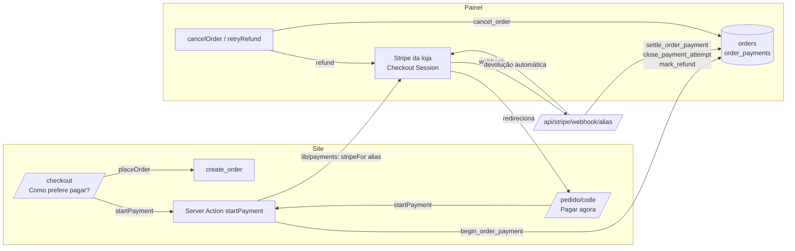

# 11 · Pagamento online (Stripe, uma conta por loja) — Design

**Spec**: `.specs/features/11-online-payment/spec.md`
**Status**: Approved (2026-10-21, "aprovado, pode seguir com o design e as tasks")

---

## Architecture Overview



O pedido continua nascendo no `create_order`, sem mudança. Pagar é um passo depois dele: cada tentativa vira uma linha em `order_payments`, presa à conta Stripe da loja. Quem decide se um pagamento vale é o banco (`settle_order_payment`), chamado pelo webhook da conta; o servidor só fala com a Stripe e repassa.

**Por que uma tabela de tentativas e não colunas em `orders`:** um pedido pode abrir várias sessões (desistiu e voltou, duas abas) e, em caso raro, receber dois pagamentos. Cada sessão precisa da sua conta, valor, situação e devolução. `orders` ganha só um resumo (`payment_status`) para a lista do painel, o Realtime e a página pública.

**Por que o banco decide e não o webhook:** as regras de "pedido cancelado", "expirou sem estoque" e "já pago" dependem de travas de linha no pedido e no estoque, como o resto do sistema (regras 1 e 2). O webhook só traduz o evento da Stripe e executa a devolução que o banco pedir.

**Contas:** a loja aponta para um apelido (`stores.payment_account`); as chaves vivem em variáveis de ambiente com o apelido no nome. `lib/payments` é o único lugar que lê essas variáveis e cria o client da Stripe.

---

## Banco

### Migration 1 · `20261021000100_online_payment_enums.sql`

Separada porque valor novo de enum só pode ser usado depois do commit (lição da etapa 10).

```sql
create type public.order_payment_status as enum (
  'nenhum',       -- nunca abriu pagamento (ou todas as tentativas expiraram)
  'pagando',      -- há sessão aberta
  'pago',
  'devolvendo',   -- devolução pedida, a Stripe ainda não concluiu (Pix pode demorar)
  'devolvido',
  'falha_devolucao',
  'conferir'      -- pagamento chegou com valor/moeda diferente
);
create type public.payment_attempt_status as enum (
  'aberto', 'pago', 'expirado', 'falhou', 'cancelado', 'erro',
  'conferir', 'devolvendo', 'devolvido', 'falha_devolucao'
);
```

### Migration 2 · `20261021000200_online_payment.sql`

**Colunas novas**

```sql
alter table public.stores
  add column payment_account text
    check (payment_account ~ '^[a-z0-9]{2,20}$');

alter table public.orders
  add column payment_status public.order_payment_status not null default 'nenhum';
```

`payment_account` nulo = loja sem pagamento online. O apelido é o mesmo que aparece no nome das variáveis (`loja1` → `STRIPE_LOJA1_*`).

**Tabela de tentativas**

```sql
create table public.order_payments (
  id uuid primary key default gen_random_uuid(),
  order_id uuid not null references public.orders (id) on delete cascade,
  account text not null,                         -- D7: conta em que a sessão foi aberta
  session_id text unique,                        -- cs_...; nulo até a Stripe responder
  payment_intent_id text unique,                 -- pi_...; chega com o pagamento
  amount_cents integer not null check (amount_cents >= 50),
  status public.payment_attempt_status not null default 'aberto',
  method text check (method in ('pix', 'card')),
  refunded_cents integer not null default 0 check (refunded_cents >= 0),
  refund_id text,
  note text,                                     -- motivo da devolução automática / conferência
  expires_at timestamptz not null,
  paid_at timestamptz,
  refunded_at timestamptz,
  created_at timestamptz not null default now(),
  updated_at timestamptz not null default now()
);
create index order_payments_order_idx on public.order_payments (order_id, created_at);
-- No máximo um pagamento válido por pedido.
create unique index order_payments_one_paid_idx on public.order_payments (order_id) where status = 'pago';
-- trigger set_updated_at (já existe)
```

`amount_cents >= 50`: mínimo da Stripe (R$ 0,50). `on delete cascade` acompanha `order_items`; o registro do dinheiro também fica na Stripe.

**RLS e grants** (regras 3 e 8)

```sql
alter table public.order_payments enable row level security;
create policy "staff reads payments of visible orders" on public.order_payments
  for select to authenticated
  using (exists (select 1 from public.orders o where o.id = order_id));
grant select on public.order_payments to authenticated;
grant all on public.order_payments to service_role;
```

Sem política de escrita e sem grant para anon. `stores.payment_account` fica legível como o resto da loja (é só um apelido, não segredo). A equipe também não muda `orders.payment_status` pela API: `orders` não tem política de `update` desde a etapa 05.

**Ordem das travas** em todas as funções: primeiro o pedido, depois as tentativas (a mesma do `cancel_order`, que atualiza as tentativas depois de travar o pedido). Evita deadlock entre webhook e painel.

**Funções do pagamento** (todas `security definer`, `search_path = ''`; `revoke` de `public, anon, authenticated`; `grant execute ... to service_role`). Chamadas só do servidor com `createAdminClient()`.

| Função | Faz |
|---|---|
| `begin_order_payment(p_code, p_token) returns jsonb` | Trava o pedido pelo `code` + `public_token` (P0002 se não achar). Exige `status = 'novo'` (`CK040`), `payment_status in ('nenhum', 'pagando')` (`CK041`), loja com `payment_account` (`CK042`), menos de 5 tentativas (`CK043`), subtotal ≥ 50. Marca as tentativas `aberto` como `cancelado` e devolve os `session_id` delas. Calcula `v_until := least(greatest(o.expires_at, now() + interval '31 minutes'), now() + interval '23 hours')` (D9; a Stripe aceita de 30 min a 24 h). Estende `orders.expires_at` para `v_until + 5 min` (folga para o aviso atrasado). Insere a tentativa (`account`, `amount_cents = subtotal`, `expires_at = v_until`) e põe `payment_status = 'pagando'`. Retorna `{ payment_id, account, amount_cents, code, expires_at, stale_sessions[] }`. |
| `attach_payment_session(p_payment_id, p_session_id) returns boolean` | Grava o `session_id` (mesmo se a tentativa já foi cancelada por outra aba, para um pagamento que passe ainda ser achado). Devolve `false` quando a tentativa não está mais `aberto`: o servidor encerra essa sessão na Stripe. |
| `fail_payment_attempt(p_payment_id)` | Stripe recusou criar a sessão: tentativa `erro`; recalcula o resumo. |
| `settle_order_payment(p_account, p_session_id, p_payment_intent_id, p_amount_cents, p_currency, p_method) returns jsonb` | Ver abaixo. |
| `close_payment_attempt(p_account, p_session_id, p_status) returns jsonb` | Sessão expirou (`expirado`) ou Pix/cartão recusado (`falhou`). Só mexe em tentativa `aberto` (ou `cancelado` → `falhou`); conta diferente → `ignore`; repetido → `duplicate`. Recalcula o resumo. |
| `mark_refund(p_account, p_payment_id, p_payment_intent_id, p_refund_id, p_refund_status, p_total_refunded_cents) returns jsonb` | Resultado de uma devolução, vindo da action ou do webhook `refund.*`. Acha a tentativa pelo id ou, sem ele (devolução feita no painel da Stripe), pelo `payment_intent`. `p_refund_status` é o status da Stripe: `succeeded` grava o total devolvido da cobrança (idempotente em eventos repetidos) e vira `devolvido` quando cobre o valor; `pending` → `devolvendo`; `failed`/`canceled` → `falha_devolucao`. `pending` e falha só valem para devoluções pedidas pelo sistema (`devolvendo`/`falha_devolucao`); devolução parcial pelo painel da Stripe só atualiza o valor devolvido. Recalcula o resumo. |

**`settle_order_payment`**: o coração da etapa. Trava o pedido e depois a tentativa (achada pelo `session_id`) e devolve `{ action, payment_id, payment_intent_id }`:

| Situação | Tentativa | Pedido | `action` |
|---|---|---|---|
| Tentativa não existe ou `account` diferente de `p_account` | — | — | `ignore` (webhook responde 400) |
| `devolvendo` sem `refund_id` (a chamada à Stripe não aconteceu) | — | — | `refund` de novo (a chave de idempotência evita devolução dupla) |
| Já processada (`pago`, `devolv*`, `conferir`) | — | — | `duplicate` |
| `p_amount_cents <> amount_cents` ou `p_currency <> 'brl'` | `conferir`, `note` com o valor recebido | `payment_status = 'conferir'`; `novo` deixa de expirar (o dinheiro entrou) | `review` |
| Outra tentativa do pedido já `pago` | `devolvendo`, `note = 'Pagamento em duplicidade'` | — | `refund` |
| Pedido `cancelado` | `devolvendo`, `note = 'Pedido cancelado'` | `payment_status = 'devolvendo'` | `refund` |
| Pedido `expirado` e a nova reserva funciona | `pago` | `status = 'novo'`, `expires_at = null`, `payment_status = 'pago'` | `ok` |
| Pedido `expirado` e falta estoque | `devolvendo`, `note = 'Reserva expirada sem estoque'` | `payment_status = 'devolvendo'` | `refund` |
| Qualquer outro status (`novo`, `confirmado`, …, `entregue`) | `pago`, `paid_at`, `method`, `payment_intent_id` | `payment_status = 'pago'`, `expires_at = null` (D2) | `ok` |

Toda saída grava `payment_intent_id` e `method` na tentativa (a devolução precisa do `pi_...`). Tentativa `cancelado`, `expirado` ou `falhou` que recebe pagamento (a Stripe não conseguiu encerrar a sessão a tempo) segue a mesma tabela: dinheiro recebido nunca é ignorado.

**Refazer a reserva do pedido expirado.** Hoje só `reactivate_order` reserva de novo (e já confirma). A parte de estoque sai para um helper interno `reserve_order_again(p_order public.orders, p_reason public.stock_reason, p_actor text)`, usado pelas duas:

- `reactivate_order`: chama com `'venda'` e o nome do atendente, como hoje; depois confirma.
- `settle_order_payment`: chama com `'reserva'` e "Pagamento C67-…" dentro de um bloco `begin ... exception when sqlstate 'CK010' then ... end` (savepoint): se faltar, a transação continua e o pagamento vira devolução.
- As peças de `vitrine_kg` seguem no trigger `sync_order_pieces`, que passa a tratar também `expirado → novo` (registra `reserva` em vez de `venda`). Se faltar peça, o mesmo `CK010` cai no savepoint.
- A mudança `expirado → novo` entra em `order_events` como "Sistema" (trigger existente, `auth.uid()` nulo).

**Funções existentes que mudam** (`create or replace`, mesma assinatura e grants)

- `cancel_order`: depois de cancelar, se `payment_status = 'pago'`, marca a tentativa paga como `devolvendo` (`note = 'Pedido cancelado'`) e o pedido como `devolvendo`; tentativas `aberto` viram `cancelado`. A devolução em si é feita pela action (a função não fala com a Stripe).
- `reactivate_order`: usa `reserve_order_again`; o resto igual.
- `get_order_public`: acrescenta `payment: { status, method, attempts_left, store_has_account }`. Nada de `session_id`, valor devolvido ou nota.
- `report_summary` (P2): `online_cents` no total e por loja = soma de `amount_cents - refunded_cents` das tentativas `pago` dos pedidos contados.
- `expire_orders`: sem mudança. Pedido pago tem `expires_at = null` e nunca entra no filtro; pedido `pagando` expira no fim da sessão + 5 min, como qualquer `novo`.

**Resumo em `orders.payment_status`.** Helper interno `refresh_payment_status(p_order_id)` chamado ao fim de cada função: `pago` se houver tentativa `pago`; senão `conferir`, `falha_devolucao`, `devolvendo`, `devolvido` (nessa prioridade); senão `pagando` se houver `aberto` não vencida; senão `nenhum`. A atualização dispara o Realtime que o painel já assina em `orders`.

**Erros novos** (mapeados nas actions)

| Código | Mensagem |
|---|---|
| `CK040` | "Este pedido não aceita mais pagamento." |
| `CK041` | "Este pedido já foi pago." |
| `CK042` | "Esta loja não recebe pagamento pelo site." |
| `CK043` | "Limite de tentativas atingido. Finalize pelo WhatsApp." |

---

## Código

### `lib/payments` (só servidor, exceto o que for puro)

- `accounts.ts` (pura): `isValidAlias(alias)`; `accountEnvNames(alias) → { secretKey: "STRIPE_LOJA1_SECRET_KEY", webhookSecret: "STRIPE_LOJA1_WEBHOOK_SECRET" }`; `readAccount(alias, env = process.env) → { secretKey, webhookSecret } | null` (as duas precisam existir); `accountState(alias, env) → "ativo" | "sem_chaves" | "desligado"`. Os nomes são montados em tempo de execução (não são `NEXT_PUBLIC_*`, então o Next não precisa embutir).
- `stripe.ts` (`import "server-only"`): `stripeFor(alias)` com cache por apelido (`new Stripe(secretKey)`); lança se a conta não estiver pronta.
- `checkout-params.ts` (pura, testável): `checkoutParams({ paymentId, code, token, amountCents, expiresAt, methods, siteUrl })` monta a sessão:
  - `mode: "payment"`, `currency` via `price_data` `brl`, uma linha `"Pedido C67-000123"` com `unit_amount = amountCents`, `quantity: 1` (D3);
  - `allowed_payment_method_types` com as formas da conta (`card`, `pix`; D4). No SDK 23 (API `2026-09-30`) a sessão não aceita mais lista fixa: as formas vêm das ativadas no painel da Stripe e esta lista filtra. Pix ainda não liberado simplesmente não aparece;
  - `payment_method_options.pix.expires_after_seconds = 600`: a Stripe conta o prazo do Pix a partir de quando o cliente escolhe Pix, não da criação da sessão, então não dá para casar com o fim da sessão. 10 min para pagar o QR; um Pix escolhido no fim da sessão pode passar da folga de 5 min e cai na nova reserva ou na devolução (D10);
  - `expires_at = expiresAt` (segundos), `locale: "pt-BR"`;
  - `client_reference_id = paymentId`, `metadata` e `payment_intent_data.metadata` com `payment_id` e `order_code`;
  - `success_url = /pedido/{code}?t={token}&pagamento=ok`, `cancel_url = ...&pagamento=cancelado`.
  `checkout.ts` (`server-only`): `createCheckout(alias, params)` chama `sessions.create` com `idempotencyKey = paymentId`. `expireSessions(alias, ids)` encerra as antigas (falha ignorada e logada: a sessão expira sozinha).
- `refund.ts`: `refundPayment(alias, { paymentId, paymentIntentId })` → `refunds.create({ payment_intent, metadata: { payment_id } }, { idempotencyKey: "refund-" + paymentId })` e grava o resultado com `mark_refund` (`succeeded` → `devolvido`; `pending` → `devolvendo`; erro → `failed` → `falha_devolucao`). Em **Tentar devolver de novo** a chave ganha um sufixo (a Stripe repete a resposta de erro para a mesma chave por 24 h); devolver além do valor pago é recusado pela própria Stripe.
- `webhook.ts`: `handleStripeEvent(alias, event, deps)` com `deps = { rpc, refund }` injetáveis (teste unitário sem rede):

| Evento | Faz |
|---|---|
| `checkout.session.completed` com `payment_status = "paid"` | `settle_order_payment`; se `action = refund`, `refundPayment` |
| `checkout.session.completed` com `payment_status = "unpaid"` | nada (pagamento assíncrono ainda em curso) |
| `checkout.session.async_payment_succeeded` | igual ao pago |
| `checkout.session.async_payment_failed` | `close_payment_attempt(..., 'falhou')` |
| `checkout.session.expired` | `close_payment_attempt(..., 'expirado')` |
| `refund.created`, `refund.updated` | `mark_refund` pelo `metadata.payment_id` ou, sem ele (devolução feita no painel da Stripe), pelo `payment_intent`; em `succeeded`, o total vem de `amount_refunded` da cobrança (`charges.retrieve(refund.charge)`) |

  `method` vem de `payment_method_types` do PaymentIntent (`pix`/`card`), lido com `sessions.retrieve(id, { expand: ["payment_intent"] })` só quando o evento é de pagamento.
- `labels.ts` (pura): rótulos PT-BR do resumo e das tentativas ("Pago", "Pagando", "Devolvendo", "Devolvido", "Reembolso pendente", "Conferir"; "Pix", "Cartão").

Dependência nova: `stripe` (SDK oficial, versão fixa no `package-lock.json`). `.env.example` ganha o bloco comentado das variáveis por apelido.

### Webhook · `app/api/stripe/webhook/[account]/route.ts`

- `export const runtime = "nodejs"`, `dynamic = "force-dynamic"`. Fora do `middleware.ts` (o matcher só pega `/admin` e `/auth`).
- `const account = readAccount(params.account)`; sem conta → 404.
- Corpo cru (`await request.text()`) + `stripe-signature` → `stripe.webhooks.constructEvent(body, signature, webhookSecret)`; inválido → 400 sem tocar no banco (spec Webhook 2).
- `handleStripeEvent`; erro de banco ou de rede → 500 (a Stripe reenvia). `ignore` → 400; o resto → 200.
- Log sem dados do cliente (só `event.id`, tipo, `payment_id`).

### Site

- `lib/storefront.ts` `listCheckoutStores`: cada loja ganha `paymentsEnabled = accountState(payment_account) === "ativo"`, calculado no servidor (o navegador nunca vê a chave nem o nome da variável).
- `app/(site)/actions.ts` · `startPayment(code, token)`: Zod na borda; `begin_order_payment` (admin client) → confere `readAccount` (sem chaves → `fail_payment_attempt` e mensagem CK042) → `expireSessions` → `createCheckout` → `attach_payment_session` → `{ ok: true, url }`. Falha da Stripe → `fail_payment_attempt` e `{ ok: false, message }`. O valor vem só do banco (regra 1).
- `components/site/checkout-form.tsx`: grupo de rádio "Como prefere pagar?" quando `store.paymentsEnabled` (padrão: pagar agora); o texto "Pagamento combinado no WhatsApp" acompanha a escolha. Depois do `placeOrder` ok: escolha "site" → `clear()` e `startPayment` → `window.location.assign(url)`; se falhar, `router.push("/pedido/…&pagamento=erro")`. Escolha WhatsApp ou loja sem pagamento: fluxo de hoje.
- `components/site/pay-button.tsx` (client): "Pagar agora" na página do pedido; mesma action; estado de carregando; mensagem de erro no lugar.
- `app/(site)/pedido/[code]/page.tsx`:
  - `novo` + `payment.status in (nenhum, pagando)` + loja com conta ativa + `attempts_left > 0` → **Pagar agora** (principal) e **Finalizar no WhatsApp** (secundário).
  - `pago` → selo "Pago pelo site · Pix/Cartão" no resumo; botão **Avisar a loja no WhatsApp** com a mensagem do pedido + linha "Pago pelo site".
  - `devolvendo`/`devolvido` (pedido cancelado) → "Devolução em andamento" / "Pagamento devolvido".
  - `?pagamento=ok` com `pagando` → "Confirmando pagamento…" e `components/site/payment-poll.tsx` chama `router.refresh()` a cada 3 s por até 1 min. `?pagamento=cancelado` → "Pagamento não concluído"; `?pagamento=erro` → "Não conseguimos abrir o pagamento agora".
  - Linha do tempo sem mudança (spec Página 6); `lib/order-timeline.ts` precisa aceitar o caminho `novo → expirado → novo` (tratar como D4 da etapa 09: mostra o caminho atual).
- `lib/storefront.ts` `PublicOrder` e `getOrderPublic`: tipo do bloco `payment`.
- `lib/whatsapp.ts`: `{pagamento}` no modelo de confirmação (`"Pago pelo site"` ou vazio; P2) e a linha extra na mensagem do pedido pago.

### Painel

- `app/admin/(panel)/lojas/store-form.tsx` + `lib/validators/store.ts` + `lojas/actions.ts`: campo "Conta de pagamento online" (opcional, `isValidAlias`, gravado em minúsculas), só admin (a tela já é só admin). Abaixo do campo, a situação de `accountState` ("Ativo", "Conta sem chaves no servidor", "Desligado"), calculada no servidor.
- `lib/admin/orders.ts`: `LIST_COLUMNS` inclui `payment_status`; o detalhe traz `order_payments(*)` ordenado por `created_at`.
- `components/admin/orders/order-row.tsx`: selo "Pago" / "Pagando" / "Devolvendo" / "Reembolso pendente" / "Conferir" ao lado do status (`labels.ts`).
- `app/admin/(panel)/pedidos/[id]/page.tsx`: bloco **Pagamento** com cada tentativa relevante (pagas, devolvidas, a conferir): forma, valor, data/hora em Campo Grande, situação, nota e o `payment_intent_id` (texto, para buscar no painel da Stripe).
- `components/admin/orders/order-actions.tsx`: no diálogo de cancelar, se `payment_status = 'pago'`, o aviso "O pagamento de R$ X será devolvido ao cliente". Botão **Tentar devolver de novo** quando `falha_devolucao`.
- `app/admin/(panel)/pedidos/actions.ts`:
  - `cancelOrder`: depois do `cancel_order` (client da sessão, que confere loja e permissão), busca com o admin client as tentativas `devolvendo` sem `refund_id` daquele pedido e chama `refundPayment` com o `account` gravado (D7); também `expireSessions` das que viraram `cancelado`. Mensagem final diz se a devolução foi pedida ou ficou pendente.
  - `retryRefund(orderId)`: confere acesso lendo o pedido com o client da sessão (RLS da loja) e repete `refundPayment` para as tentativas `falha_devolucao`.
- `components/admin/orders-live.tsx`: já recarrega em qualquer evento de `orders`; o som continua só no INSERT (conferir).
- Relatório (P2): cartão "Pago pelo site" no total e por loja; CSV com colunas "Pagamento" (Pix/Cartão/vazio) e "Devolvido" (`csvCents`).

### Privacidade

O aviso curto do checkout ganha "Se você pagar pelo site, o pagamento é processado pela Stripe". O texto completo da política está em `settings.privacy_text` (provisório, AD-011): a etapa entrega um parágrafo sugerido para o admin colar em Configurações; não muda por migration.

---

## Testes

**Unitários (vitest)**
- `accounts.ts`: apelidos válidos/ inválidos, nomes das variáveis, conta com só uma das chaves = `sem_chaves`.
- `checkoutParams`: valor = subtotal do banco, uma linha, formas da conta, Pix de 10 min só quando há Pix, `expires_at` da sessão em segundos, URLs com código e token, metadata com `payment_id`.
- `handleStripeEvent` com `deps` falsos: cada evento da tabela; `refund` chama a devolução; `unpaid` não chama nada; evento desconhecido é ignorado. Assinatura com `stripe.webhooks.generateTestHeaderString` no teste da rota (válida, inválida, apelido desconhecido).
- `labels.ts`, `{pagamento}` no modelo, `order-timeline` com `novo → expirado → novo`.

**Integração (projeto real, sem rede da Stripe: as funções são chamadas direto com a service role)**
- Anon e atendente não executam as funções de pagamento (`42501`) nem leem `order_payments` de outra loja; anon não lê `order_payments`.
- `begin_order_payment`: código/token errado, loja sem conta (`CK042`), pedido confirmado (`CK040`), 6ª tentativa (`CK043`), extensão da reserva e cancelamento da tentativa anterior.
- `settle_order_payment`: pago (pedido para de expirar e `expire_orders` não o pega); repetido (`duplicate`); valor diferente (`conferir`); conta trocada (`ignore`); duas tentativas pagas (segunda `refund`); pedido cancelado (`refund`); expirado com estoque (volta a `novo`, movimento `reserva`, peça `vitrine_kg` reservada de novo) e sem estoque (`refund`, estoque intacto).
- `cancel_order` de pedido pago → tentativa `devolvendo`; `mark_refund` → `devolvido`; `reactivate_order` continua passando nos testes existentes depois do helper.
- `report_summary` com `online_cents`.

**Manual (modo de teste da Stripe)**
- Duas contas de teste (ou sandboxes), uma por apelido; `stripe listen --forward-to localhost:3000/api/stripe/webhook/loja1` (e `loja2` com outro `--forward-to`/conta).
- Cartão de teste aprovado e recusado; Pix de teste; desistir na página da Stripe; deixar expirar; pagar em duas abas; cancelar pedido pago; loja sem apelido e loja com apelido sem chaves.

---

## Riscos

- **Pix pode depender de liberação da Stripe.** Com `allowed_payment_method_types`, um Pix não liberado só não aparece na página da Stripe (a sessão abre com cartão). Pix e cartão precisam estar ativados em Configurações → Formas de pagamento de cada conta Stripe. `STRIPE_<APELIDO>_METHODS` (opcional, padrão `card,pix`) ainda permite tirar uma forma sem mexer no painel da Stripe.
- **Aviso atrasado depois da expiração.** Coberto pela folga de 5 min e, além dela, pela nova reserva ou devolução automática.
- **`reactivate_order` muda por dentro.** O helper copia a lógica atual; os testes de operação e de peças rodam de novo.
- **Devolução não volta a tarifa.** Cancelar pedido pago custa a tarifa da Stripe; o diálogo de cancelar deixa claro que haverá devolução.
- **Vercel Hobby (AD-017/AD-019).** Risco de uso comercial aceito pelo Leonardo. Tecnicamente nada muda: o webhook é uma função comum, rápida, e a Stripe reenvia se falhar.
- **Deploy.** As duas migrations só acrescentam (colunas com padrão, tabela nova, funções recriadas com a mesma assinatura), então podem ir antes do merge. Sem `payment_account` preenchido e sem variáveis, o site no ar continua igual.
